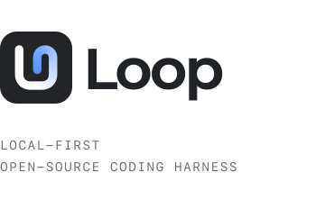
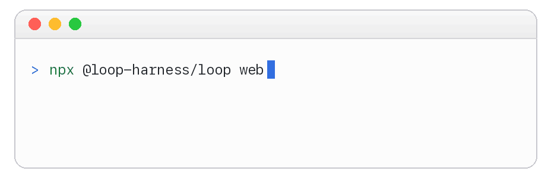
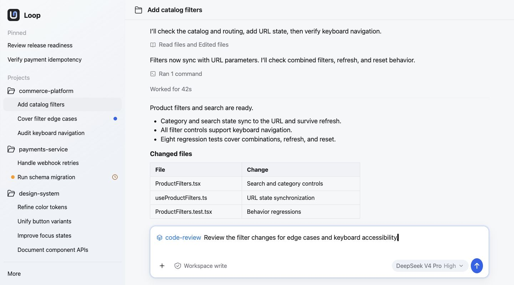

<p align="center">
  <picture>
    <source media="(prefers-color-scheme: dark)" srcset="docs/assets/readme/brand-dark.svg">
    
  </picture>
  <picture>
    <source media="(prefers-reduced-motion: reduce) and (prefers-color-scheme: dark)" srcset="docs/assets/readme/terminal-dark.png">
    <source media="(prefers-reduced-motion: reduce)" srcset="docs/assets/readme/terminal-light.png">
    <source media="(prefers-color-scheme: dark)" srcset="docs/assets/readme/terminal-dark.gif">
    
  </picture>
</p>

<p align="center">
  <a href="https://jimmydi.github.io/loop/">
    <picture>
      <source media="(prefers-color-scheme: dark)" srcset="docs/assets/readme/website-dark.svg">
      
    </picture>
  </a>
  <a href="https://nodejs.org/">
    
  </a>
  <a href="https://www.typescriptlang.org/">
    
  </a>
  <a href="LICENSE">
    
  </a>
</p>

# Loop

Loop is a local-first, open-source coding harness built with TypeScript. Use it in your browser or terminal, or integrate it through the TypeScript SDK, to read and edit files and run commands in your projects. Connect your preferred model provider to get started.

<p align="center">
  <picture>
    <source media="(prefers-color-scheme: dark)" srcset="docs/assets/readme/product-dark.webp">
    
  </picture>
</p>

## What can Loop do?

Loop can:

- work in your browser or terminal, or inside your application through the TypeScript SDK
- read and edit project files, run shell commands, and execute your tests
- connect to built-in model providers, custom gateways, and compatible local model endpoints
- save conversations by project and restore previous sessions to continue your work
- load reusable Skills and use external MCP tools in the Web UI or through the SDK
- compact long conversations automatically or on demand while preserving the original history
- control tool access with permission presets and approve operations that need additional access

## Why Loop

- **Local-first:** work directly in your projects, with conversations and settings stored on your machine.
- **Three ways to work:** use the Web UI, CLI, or TypeScript SDK with the same session and tool APIs.
- **Model choice:** choose your provider and model, including compatible gateways and local endpoints.
- **Controlled execution:** set read-only, workspace-write, or full-access permissions and review approval requests.
- **A focused core:** a single-agent loop with inspectable TypeScript code, reusable Skills, and MCP integrations.

## Start

With Node.js 24+ installed, start the published Web UI:

```bash
npx @loop-harness/loop web
```

The browser opens when the local service is ready. Configure providers in Settings → Models. The published package includes the CLI, SDK and prebuilt Web UI; no Bun or frontend build tools are required.

Optional local speech input and calls are configured in Settings → Voice. Resources are installed explicitly on the backend computer; see [voice setup and limits](packages/web-ui/src/frontend/docs/voice.md).

## Local development

Requires Node.js 24+ and pnpm 11. Install dependencies and start the Web UI:

```bash
pnpm run sync
pnpm dev
```

Run `pnpm run sync` from the repository root to install dependencies from the committed lockfile. It fails if the lockfile is missing or inconsistent with package manifests. This command does not pull Git changes. Use `pnpm add`, `pnpm update` or `pnpm install` when intentionally changing dependencies and updating the lockfile.

The browser opens when the loopback service is ready. Configure providers in Settings → Models.

Development serves React through Vite middleware on the same port as the API; frontend changes use HMR. A stable development gateway keeps the private tunnel and device authorization alive while backend source edits restart only the business worker.

For the CLI, configure LOOP_AI_PROVIDER, LOOP_MODEL and LOOP_AI_API_KEY in the environment or a local .env, then run pnpm coding-agent. See [models](packages/coding-agent/src/docs/models.md) for compatible gateways and configuration.

Build and launch the production application:

```bash
pnpm build
node dist/bin.js web
node dist/bin.js web --port 3081 --no-open
node dist/bin.js --help
```

The public npm package is `@loop-harness/loop`; the installed executable remains `loop`. See [distribution](docs/development.md#distribution) for packaging and publication.

## Architecture

| Package | Responsibility |
| --- | --- |
| packages/agent | In-memory model and sequential tool loop |
| packages/coding-agent | Sessions, permissions, tools, persistence, CLI and SDK |
| packages/web-ui | Frontend, backend and shared protocol |
| packages/telemetry | Local trace recording, storage and retention |

All four are private workspace packages with independent manifests and public exports, bundled into the root distribution. Root bin.ts and sdk.ts are application distribution entries. Commands flow Web/CLI/SDK → coding-agent → agent → model API. Events flow upward through subscriptions. Only the model-runtime module configures and injects the model runtime; the loop initiates requests. pnpm check:architecture enforces dependencies and rejects cycles and private imports.

Loop remains single-agent. Reliability, safety, recoverability and usability determine maturity.

## Documentation

The manually maintained [marketing website](website/README.md) lives in `website/`, with its own development and static build commands. It is independent of Loop application code and excluded from the application build and published package.

| Area | Entry |
| --- | --- |
| Agent API, events and tools | [Agent](packages/agent/README.md) |
| SDK, CLI, models and sessions | [Coding-agent](packages/coding-agent/README.md) |
| Local execution logs | [Telemetry](packages/telemetry/README.md) |
| Browser application and server | [Web UI](packages/web-ui/README.md) |
| Development, build and distribution | [Development](docs/development.md) |
| README artwork and repository social preview | [Artwork](docs/assets/readme/README.md) |

## Validation

Run pnpm typecheck, pnpm check, pnpm build and pnpm test. Use affected tests by default; the build is required for distribution startup tests. Model tests use synthetic local responses. The CLI PTY test requires Python 3. Confined shell tests require macOS Seatbelt or Linux Bubblewrap.

See [Changelog](CHANGELOG.md), [Contributing](CONTRIBUTING.md), [Security](SECURITY.md) and [License](LICENSE).

## License scope

The [MIT License](LICENSE) covers the software and documentation, except for the Loop icon artwork identified in the [brand asset policy](packages/web-ui/src/docs/assets/loop-brand/BRAND-ASSETS.md). That artwork is reserved under the separate policy, including copies in documentation and Loop-Icon-Delivery.zip. This exception does not restrict the software code or grant trademark rights. Bundled fonts remain under their own [SIL Open Font License](packages/web-ui/src/docs/assets/loop-brand/fonts/OFL.txt). Previously granted valid licenses are not revoked by this notice.
