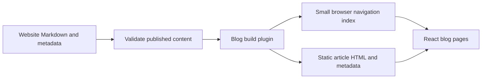

# Loop website blog proposal

Status: implemented baseline; see [website maintenance](../README.md#blog) for the actual content contract and current limits. Research date: 2026-11-03.

## Decision

Add an independently authored engineering blog to the existing static website. Use a full-width editorial article grid without a left sidebar or visible Blog heading. The latest article spans two of at most three columns; all others span one.
Blog language follows the existing website setting. Preserve the brand, Light/Dark appearance and
bilingual navigation. Use a focused article layout rather than the documentation tree.

The selected direction follows the user's preference for the layout of the inspected
[article listing](https://claude.com/resources/articles?page=2): generous whitespace,
typography-led cards. The final layout omits the sidebar and large Blog heading. Keep Loop's own identity, copy and
illustrations. This supersedes the earlier text-list recommendation.

The concept uses fictional article titles and approximate reading times. It does not
represent published articles or product claims.

## Research observations

These observations describe pages inspected directly, not the vendors' implementation stacks.

| Source | Observed interface | Application to Loop |
| --- | --- | --- |
| [Cursor blog](https://cursor.com/blog) | Prominent featured stories, categories, search, author and reading-time metadata, more-content control; separate customer and changelog sections | Feature one article; keep Blog distinct from release history |
| [Cursor article](https://cursor.com/blog/git-at-any-scale) | Blog/category breadcrumb, author/date/reading time, section anchors, table of contents, explanatory visuals and related posts | Make long technical articles navigable and easy to continue reading |
| [Claude Articles](https://claude.com/resources/articles?page=2) | Narrow sidebar, wide main column, large heading, featured carousel, search and editorial card grid | Primary reference for card styling and typography; omit the sidebar and large heading as requested |
| [Claude Code article](https://claude.com/resources/articles/how-to-manage-costs-and-demonstrate-roi-for-claude-code-on-google-cloud) | Summary, category/product/date/reading-time metadata, copy-link action, diagrams, related reading and newsletter | Provide a useful summary and restrained article actions |
| [Devin blog](https://devin.ai/blog) | Generous spacing, one image-and-text feature, category links, article summaries, dates, reading times and an archive link | Secondary reference for article metadata |
| [Devin article](https://devin.ai/blog/devin-security-2) | Back link, large title, date and reading time, copy link, PDF action and table of contents | Use back link, copy link and TOC; PDF export is unnecessary for the initial scope |
| [Cline blog](https://cline.bot/blog) | Image-led editorial columns, featured story, author attribution, recent-writing sidebar and archive | Retain human authorship; avoid its heavier image-production burden |

The requested Windsurf blog URL redirected to the Devin blog during this inspection. It is
not counted as a separate verified design. The official Codex developer-blog URL returned
403 and the web search connector failed; no Codex interface findings are asserted. Sources
are illustrative samples rather than a market-share ranking.

## Information architecture and content

- Global navigation: Docs / Changelog / Blog; add Blog in SiteHeader and SiteFooter.
- Docs answers how to use a shipped capability. Changelog records published changes. Blog
  explains engineering decisions, product thinking and practical workflows.
- Initial editorial categories: Engineering, Product and Guides. Show a category on each
  article; render filter controls only after multiple populated categories justify them.
- Launch with one to three complete articles. Do not publish empty categories, placeholder
  stories or an empty blog entry point.
- Suggested subjects: sequential agent-loop design, context management, and controllable
  long-running tasks. Verify every product claim against the published release.

## Index design

- The top website toolbar and complete content layout share a 1400px outer container,
  with 32px desktop and 20px mobile gutters. The toolbar spans the entire
  article grid, with both edges aligned to the content edges. Brand and navigation stay
  left; GitHub and website language controls stay right. On blog pages, scrolling must not
  shrink the toolbar below the overall content width. Its sticky surface covers that full
  width; reserve its height so it does not obscure the first heading.
- No sidebar, category navigation or large visible Blog heading. Retain the global Blog link.
- Main area: introduction, search and one shared article grid filling the content width.
- Wide screens: at most three equal-width columns. The latest published article spans two
  columns; the next article occupies the third column in the same row. Every other article
  spans one column, with up to three articles per subsequent row.
- Select the latest article by publication date with a stable slug tie-break. Its optional
  illustration stays inside the card; do not duplicate it in a separate feature section.
- Tablet: two columns, latest spanning both. Mobile: one column, all cards spanning one.
  Keep chronological DOM and visual order without dense placement.
- Cards have fine borders, date/category metadata, titles, summaries and reading times.
  Individual cover images are optional.
- Use a warm neutral article palette: page #faf9f5, card #f5f4ed, text #141413,
  secondary text #5e5d59 and border #e8e6dc. Keep blue for the active global navigation.
  Dark equivalents in the concept are a proposed adaptation, not measured reference colors.
- Card styling: 16px radius, 1px border, no resting shadow, 24px grid gap. Header strip
  uses 12px text with 1.6 line height and 12px/24px vertical/horizontal padding.
- Normal article titles: 31px, weight 500, approximately 1.15 line height; latest title
  scales from 30px to 42px. Use Georgia with Chinese system serif fallbacks; do not copy
  proprietary font assets. Summaries use 15px system sans, 1.6 line height.
- Body padding: 32px desktop and 24px mobile. Pin author/reading-time metadata to the
  lower body edge. The latest card shares the same full-width metadata strip and places
  title/summary beside its optional illustration. Preserve chronological three-column order.
- Search title/summary metadata locally; without category navigation. Filter all cards,
  including the latest article; preserve its two-column span when it matches. Show a useful
  empty state and omit empty categories. The concept
  uses fictional records to demonstrate filtering, not launch content commitments.
- Render the full initial archive; add static pagination as content grows. The inspected
  reference exposes View more; its page=2 entry initially showed 23 resources before the
  browser normalized the URL. This does not establish a conventional numbered second page.
- On tablet, use two columns; on mobile, use one. Do not add a sidebar or category row.

## Article design and interaction

- Back-to-blog link, category, title, summary, author, publication date, optional meaningful
  update date, estimated reading time and Copy link.
- Main text column 680–720px; 17–18px body text, approximately 1.8 Chinese line height.
  Keep the existing brand font for headings and use system fonts for long body copy.
- On wide screens, place a compact sticky TOC to the right when there are at least three
  substantive sections. On mobile, use a collapsible TOC before the body.
- Support stable section anchors, code language labels and copy buttons, image alt text,
  captions, and a no-motion image enlargement overlay with Escape/close and focus return.
  Images fit the article; only code blocks and genuinely wide tables scroll horizontally.
- Related reading: at most two same-language articles; show nothing when none exists.
  End with a quiet link to relevant published documentation.
- Internal navigation keeps the site mounted. Back restores the list position; modified
  clicks retain normal browser behavior. Loading preserves current content; failed fetches
  fall back to ordinary page navigation. Move focus to the new heading and announce loading
  accessibly. These are acceptance requirements, not all existing hook guarantees.
- Copy link reports success or failure. Public articles require complete translation pairs.
  Language changes keep the same article and update its body together with the site chrome.
- Defer comments, accounts, newsletter infrastructure and PDF export. RSS can follow the
  first content release without changing the article schema.

## Bilingual routing and metadata

Use the existing website LanguageProvider and header language switch. There is no separate
blog language setting or locale path. Entering Blog retains the current website language;
changing it updates navigation, categories, article titles, summaries, body and metadata.
Reloads follow the website's existing browser-preference initialization, with no new storage.

```text
/blog/                    index in the website language
/blog/<slug>/             article in the website language
```

Generate Chinese static markup and an inert English template using the existing website
strategy. A public article needs both languages; incomplete public pairs fail validation.
Draft pairs may remain incomplete. The same article stays available when language changes.

- Each article has one self-referencing canonical shared by both language presentations.
  Do not advertise different hreflang targets for identical URLs. Crawlers and social
  previews primarily see the default static language; independently indexed translations
  are outside this scope.
- Use a configured public site origin plus deployment base path to construct absolute URLs.
  Do not hard-code a deployment address from the attachment. Preview builds do not advertise
  localhost or preview origins as public canonicals.
- Emit per-route static title, description, canonical, Open Graph article fields, social
  image when available, and BlogPosting JSON-LD. Metadata and document language remain
  consistent after hydration, language changes and client navigation.
- Generate sitemap entries only for published routes. If RSS is added, generate separate
  language feeds. Neither feed nor sitemap includes drafts.
- Unknown slugs use a real static-host 404 response with a site-styled 404.html, not homepage
  fallback content or a successful response advertising a nonexistent article.
- Generate trailing-slash directory routes with index.html. Verify direct deep links on
  the actual host; a missing trailing slash is not inherently a GitHub Pages 404.

## Content pipeline

Keep authored blog sources under website/content/blog. A paired filename such as
agent-loop.zh.md and agent-loop.en.md defines slug and locale; validate any duplicated
frontmatter values against it rather than maintaining independent sources of truth.

```yaml
title: A clear agent loop
summary: Engineering decisions behind a sequential tool loop.
publishedAt: 2026-11-03
author: Loop
category: engineering
draft: true
```

Optional metadata: updatedAt, tags, cover, coverAlt and a reviewed external canonical for
an intentional republication. Normal canonicals and reading-time estimates are generated.
Dates use ISO calendar dates, avoiding timezone-dependent day shifts. Public articles require
complete Chinese/English pairs. Invalid dates, duplicate locale/slug pairs, unknown categories,
missing required fields and broken local assets fail the content build. Drafts are excluded
from all public outputs. Publishing is explicit; scheduled publication is outside initial scope.

Use public/blog/<slug>/ for assets and rewrite local Markdown image paths against the known
article asset directory and Vite base. Never resolve images against the browser's current
article path or allow traversal outside the article directory.



Create a separate blog plugin and virtual:blog-content contract. Reuse heading IDs and safe
Markdown primitives through a focused website-local renderer only where behavior truly
matches. Do not copy release-catalog coupling or enable images globally for released docs.
Keep raw HTML disabled, escape generated attributes, permit only intended URL schemes,
and prefer local image assets; external images need an explicit policy and no-referrer.
Use native theme-aware code CSS or a build-time highlighter rather than a browser-loaded
highlighter. Reviewed images must remain readable in both themes; product captures require
native Light/Dark pairs under website instructions.

The browser bundle receives metadata/headings, not all article bodies. Each article body
already exists in its static HTML, and client navigation can fetch that HTML on demand.
Ensure image src/srcset URLs work after article extraction; the current hook only rewrites
anchor href values. Add development watch/invalidation so Markdown edits appear in Vite.

## Verified reuse and attachment corrections

| Existing file or assumption | Decision |
| --- | --- |
| [App](../src/App.tsx), [routes](../src/content-routes.ts), [navigation](../src/components/useContentNavigation.ts) | Extend route resolution and navigation; distinguish unknown blog paths from home |
| [Content plugin](../scripts/content-plugin.ts) | Reuse the virtual-module pattern, not release-specific link rewriting and catalog loading |
| [Content article](../src/components/ContentArticle.tsx) | Reuse safe static-body presentation with blog-specific typography and image/code support |
| [Build](../scripts/build.mjs), [prerender](../src/prerender.tsx) | Extend route generation and per-route head output |
| [Page metadata](../src/page-metadata.ts), [language bootstrap](../src/i18n/initializeLanguage.ts), [provider](../src/i18n/LanguageProvider.tsx) | Coordinate all three; changing only pageTitle would allow homepage metadata to overwrite article metadata |
| Navigation location | The global entry belongs in SiteHeader and SiteFooter; DocsNavigation is the documentation sidebar |
| 650 KB remote.html budget | Belongs to the application Web backend, not this independent website. Measure website entry JS and static article bytes separately |
| Release gating | Docs and Changelog remain npm-confirmed snapshots. Blog is independently authored; it must not expose Unreleased notes or working-tree application docs |
| Framework | Retain React, Vite, CSS Modules and static hosting. No CMS, database, Next.js or MDX requirement |

## Delivery order and acceptance

1. Confirm content schema, shared routes, website-language behavior and initial content.
2. Implement parser validation, safe renderer, asset paths and the small virtual index.
3. Implement list/article layouts, global entry points and accessible navigation.
4. Implement bilingual static HTML, route-aware metadata/hydration, sitemap and 404.
5. Validate public output before deployment.

Targeted colocated tests should cover schema errors and drafts, route/base handling, language
pair completeness and website-language switching, unsafe URLs and escaping, article fetch cancellation,
navigation metadata and hydration, and static HTML with complete article content. Verify
both themes, mobile layout, deep links, Back/Forward, keyboard operation and no-JavaScript
reading. Run website typecheck, Biome checks, affected tests, website architecture checks
when imports change, and the website production build. Do not run application suites for
this isolated feature without a concrete dependency.

The implemented baseline has a Website entry under Unreleased. The research and target
design are historical planning context; the website README documents supported behavior. The selected
concept is [blog-editorial.html](blog-editorial.html). The superseded early alternatives
remain in [blog-concept.html](blog-concept.html); neither is wired into the production site.
